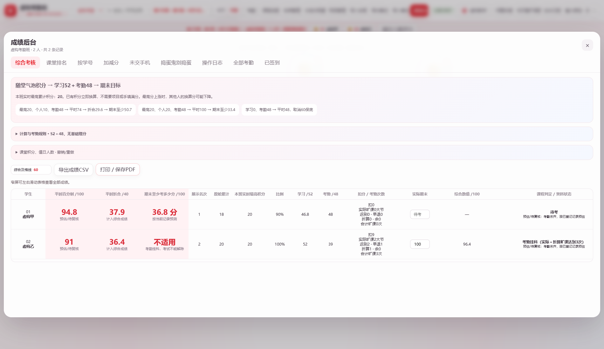

# 课堂气泡赋分系统

[正式站](https://classroom-bubble-score.zcq991029.chatgpt.site) · [GitHub源码](https://github.com/zcq19991029/classroom-bubble-score) · [使用指南](docs/使用指南.md) · [课表说明](课表使用说明.md)

课堂随堂加减分、分组、考勤和综合成绩工具。正式入口为`cloud.html`，权威数据为同站Sites Worker＋D1 `DB`，账号和班级隔离。GitHub保存源码，不提供替代数据后端。当前计算沿用气泡学期累计与本班实时最高累计的比例，不采用项目满分。

## 当前成绩规则

- 学习：`52×clamp(个人学期累计积分÷本班实时最高累计积分,0,1)`，0～52；历史累计直接参与，不重复叠加日志或分类奖惩。
- 考勤：`max(0,48−累计考勤扣分)`，0～48。48课时＝24大节，每小节40分钟、每大节80分钟；不覆盖真实课表。
- 默认迟到1、早退1、旷课3；历史`deduction`快照优先，旧自定义早退设置优先于新默认值，其他原因不猜分类。
- 迟到＋早退每3次折算1次旷课，保留余数。实际＋折算旷课达到3次，按本课程规则显示考勤挂科，期末目标不适用。折算不再重复扣3分。
- 平时＝学习＋考勤，无40基础分、无60保底；最高累计变化时，其他人的换算分也可能变化。
- 平时占40%，期末占60%。折合仅显示保留1位，期末目标和综合计算使用完整`平时×0.4`，不拿已舍入的折合继续运算。
- 期末需考＝`max(0,(及格线−平时×0.4)/0.6)`，向上取0.1；超过100明确提示。实际期末空白待考，0有效。
- 例：平时94.8，完整折合37.92（显示37.9），期末至少36.8。考勤挂科即使考试100也不解除，综合数值只供核对。

基础待确认/待补做、考勤未齐或关联不明时显示预估/待复核，不赠分、不补签到。稳定课次及alias去重，每课次采用最新记录；未知关联不虚构次数。网页、CSV、打印共用模型，分别显示实际旷课、迟到、早退、折算、余数和合计。

## 功能与数据保护

- 气泡加减分、鼠标拖动和碰撞；按姓名/学号搜索；锁定显示表情，解锁显示姓名末字＋学号后两位。
- 公共池＋单组选项卡分组，默认锁定；容量、组长、班委皇冠、按组每人加1分。
- 值日`5×参与/应到`，保留两位；成员、人数和分数一起保存与撤销/重做，旧手填记录不倒推人数。
- 签到、异常考勤、自定义原因和历史扣分快照；校历、稳定课次、调课、归档和课程进度沿用原有规则。
- 教师账号、一次性邀请码、管理员权限、资料与反馈；不把管理员身份当跨教师成绩读取权限。
- 离线待同步箱、`expectedUpdatedAt` CAS冲突保护、完整JSON备份。班级可恢复移出，原数据留在同账号`archivedClasses`。
- 若浏览器留有旧冲突副本，同步状态可导出它；点击“保留本机副本并读云端”会再将副本保留到按账号隔离的本机历史槽，仅GET读取最新云端，不把旧班级/考勤覆盖回D1。
- 工器1/2班、电气8班继续归档。原维护测试班从默认班级选择和管理界面隐藏，数据仍保留在完整备份中，不自动删除或恢复。

## 入口与目录

| 文件/目录 | 用途 |
|---|---|
| `cloud.html` / `d1-cloud.js` | 正式UI、账号、工作区同步 |
| `index.html` | 本地演示；相同成绩模型，不是独立生产后端 |
| `assessment-model.js` | 派生成绩、考勤扣分与折算、精度规则 |
| `assessment-ui.js` / `assessment-entry.js` | 网页、CSV、打印及原始积分/值日录入 |
| `class-archive.js` | 班级可恢复移出与恢复 |
| `worker/` / `drizzle/` | Worker API、D1迁移 |
| `schedule-manager.js` / `school-calendar.js` | 稳定课次、课表和校历 |
| `scripts/` | 构建、隔离测试和只读审计 |
| `dist/` | 当前Worker及迁移发布产物 |
| `history/` | 旧文档、旧截图和旧迁移源码，均不参与运行 |
| `history/local-releases/` | 本机旧发布包，Git忽略；清单见`history/release-archives.json` |
| `tmp/` | Git忽略的私有备份、隔离导出和发布临时文件 |

## 构建与验证

本机所有shell命令以`rtk`开头，原生HTML/JS，不使用React。构建：

```text
rtk proxy node scripts/build-worker.mjs
rtk proxy node scripts/test-criterion.cjs
rtk proxy node scripts/test-attendance-browser.cjs
rtk proxy node scripts/test-criterion-browser.cjs
rtk proxy node scripts/test-cloud-sync.cjs
rtk proxy node scripts/test-workspace-cas.cjs
```

另运行本轮相关的校历、课表、班级归档、分组、气泡输入/物理和反馈测试。浏览器测试使用独立虚构工作区，不向正式学生写分或考勤；Worker测试使用内存SQLite。真实设备、第二教师与学校网络验收不能由这些测试替代。

构建会嵌入20项静态资产，正式根路由指向`cloud.html`。推送GitHub后，用同一完整SHA打包、`save_site_version`核对SHA再发布现有Sites，保持权限。发布前后经正式UI导出完整工作区，对比所有业务字段和`archivedClasses`，只公开汇总，禁止公开名单、备份或凭据。

## 清理与历史

已将17份旧发布压缩包移出根目录及源码索引，保留在本机历史目录并记录SHA256；2份旧文档副本、6张旧模型截图和3份旧Supabase迁移文件归档。正式HTML中禁用的Supabase脚本已移除，正式API仍只有当前Worker/D1。未删除学生备份、课表、生产历史或技能原件。

旧规则与历次验证快照见[历史README](history/docs/README-before-attendance-fix.md)和[历史交接](history/docs/项目交接截至20261018.md)。旧项目公式、旧“不折算”说明均不再生效。当前发布和真实回读见[项目交接](项目交接.md)。



本轮正式回读：页面标记2026-10-18 02:09，默认仅两个机电班，原维护测试班仍保留在完整备份；原3个归档班未恢复。发布前后完整UI备份中所有班级业务字段及archivedClasses一致（仅忽略自动保存时间）。14个相关测试脚本通过，DB健康接口正常。真实早退输入1和新规则说明已核对，既有其他扣分设置未改。


