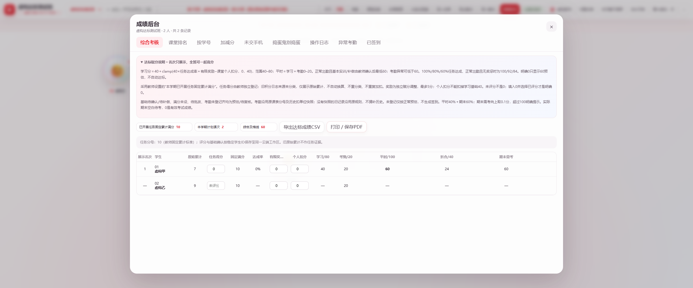

# 达标赋分使用指南

打开「成绩后台 → 综合考核」。正式站仍使用同站 Worker + D1；本地演示入口使用同一模型。

1. 教师先设置「已开展任务固定累计满分」。这是本学期已经开展任务的固定总目标，不是班级最高积分，不自动从旧日志或任务数量推断。留空表示待设置。
2. 按学生登记独立任务得分，再选「已评分」。未批改保持空白和「待批改」；确实得到0分时填写0，再选已评分。原始累计积分只展示，旧日志不自动分类成任务、奖励或扣分。
3. 如有额外奖励/纪律扣分，单独登记其对学习赋分的调整；奖励0–5，个人扣分非负。同一事实不能同时记入任务分和额外奖惩。若同一事项已反映在任务评价中，不再重复扣。
4. 核对基本实训或补做与基本出勤要求，再由教师选「基本实训/补做已满足」。0分不自动证明基础已完成；未完成选「待补做」，尚未核对选「基础待确认」。
5. 考勤继续在原考勤入口登记。已登记记录有扣单位快照时按快照；旧记录没有快照时沿用原设置/原因规则，不猜补快照。修改规则不改写已有快照。考勤扣分不重复扣原始气泡积分。
6. 实际期末填写0–100，空白表示待考。导出CSV或打印/保存PDF均带预估与基础状态。

## 公式与边界

任务达成率＝独立任务得分÷教师固定满分，计算时限制0–100%。

学习分＝40＋clamp(40×任务达成率＋有限奖励−个人扣分，0，40)，范围40–80。

考勤分沿用本项目计划课次和扣单位规则，限制0–20。平时＝学习＋考勤；平时折合＝平时×40%；综合＝折合＋期末×60%。

正常出勤、无额外奖惩时：任务100%/80%/60%对应平时100/92/84。明确0为60预估；基本要求必须另行教师确认。考勤异常可以低于60。全班达标可一起高分，甲进步不降低乙的分数；展示名次不参与赋分。

期末需考＝max(0,(及格线−平时折合)÷0.6)，向上取0.1分。超过100显示实际所需分数及「超过100」，不截为100。

## 预估与数据

未设任务满分或待批改时学习/平时显示「—」；基础未确认、待补做或考勤未齐均显示「预估/待复核」。考勤完整性按课表中截至当天的课次及稳定ID/别名核对；没有有效课表不能判定齐全。未登记考勤可按正常预估，不创建签到。

新增字段为班级 `criterionAssessment.taskTarget` 与 `criterionAssessment.students`，学生键优先稳定内部ID、缺失时完整学号。状态为 `pending/graded` 和 `pending/met/makeup`。这些字段随原工作区快照、待同步箱和CAS进入D1，不替换score/logs/attendance/homework/examScores/课表/课程进度。

图中为虚构数据；表格可横向滚动，右侧含期末、基础确认与预估状态。
