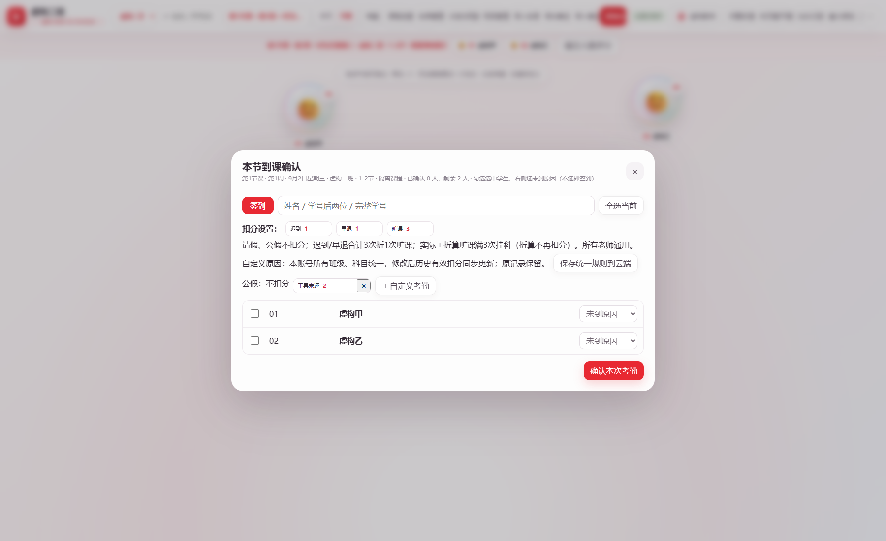

# 随堂气泡积分：学习52＋考勤48

课堂气泡不按项目评分。教师照常给气泡或小组加减原始积分，网站用当前班级学期累计积分自动换算，无须补录项目。2026-10-18起，旧“项目每项5分”“学习40基础分”“平时60保底”公式均废止。旧项目配置和历史日志保留在工作区备份中，但不再作为换算分母或额外加减项。

## 计算与显示

- 参考满分：当前班级所有学生中最高的学期累计积分，实时更新。
- 学习分：`52×clamp(个人累计积分÷实时最高积分,0,1)`，范围0～52，无赠送基础分。
- 考勤分：`max(0,48−累计考勤扣分)`，范围0～48，直接扣分，不按课表次数缩放。
- 平时百分制：学习＋考勤；折合40分：平时×40%。
- 综合数值：`平时×0.4＋实际期末×0.6`，计算完后保留一位小数。
- 期末至少需考：`max(0,(及格线−平时×0.4)÷0.6)`，使用未提前舍入的折合值，向上取到0.1；超过100显示实际所需并提示无法达到。

学习、平时、折合显示保留一位小数；折合只作显示，不拿已经舍入的显示值继续计算期末目标或综合分。例：最高20、个人18、全勤48，平时94.8，完整折合37.92（显示37.9），期末至少36.8。实际期末允许0～100，空白是待考，0是有效成绩。基础“待确认/已满足/待补做”只表示资料状态，不赠分，不阻止展示计算结果。

例：本班最高20分，个人10分，考勤48 → 学习26、平时74、折合29.6、期末至少50.7。最高20、个人20且考勤48 → 平时100、期末至少33.4。学习0、考勤48 → 平时48，无60保底。全班没有正累计积分时，学习暂按0并明确标注预估，避免除零。

**最高分实时上升，其他人的换算分可能下降。**例如最高20变25、个人仍10：平时74变68.8（均按考勤48）。这是教师已选择的相对参考方式。不是按名次分档，但也不再承诺同伴加分不影响本人。

## 考勤课时、扣分和三次旷课

48课时＝24大节；一小节40分钟，一大节80分钟。48是考勤分满分，不覆盖已有课表、调课、取消课次及归档。实际应登记的课次仍沿用原班级课表。

所有老师统一默认：签到、请假、公假扣0；迟到、早退扣1；旷课每大节扣3。原记录和旧快照保留备查，标准类别有效扣分采用新统一规则。自定义原因在本账号所有班级、科目共用；修改后历史有效扣分同步重算，原记录不重写。旧同名规则冲突显示待统一，不擅自选择扣分。点击“保存统一规则到云端”后配置进入D1，换设备可恢复。不重复扣气泡原始积分。

**迟到＋早退每3次折算1次旷课，保留不足3次余数；实际旷课＋折算旷课合计达到3次，即按本课程规则考勤挂科。**折算不再次扣3分。除明确的迟到/早退外，自定义原因不猜测为旷课。这是教师确认的本课程规则，不是对学校统一政策的断言。同一稳定课次只计一次，以最新更正记录为准；课次别名及已归档课次先按稳定ID匹配。未关联课次的记录标注待核对，不凭空推算旷课次数。

迟到2次＋早退1次：只扣原有3分，考勤45，折算1次旷课；再有2次实际旷课：共扣9分，考勤39，合计3次旷课，显示挂科。9次迟到也触发，8次迟到折算2次、余2次，不触发。即使学习52、实际期末100，综合数值96.4也只供核对，课程判定仍为考勤挂科，期末目标显示“不适用”。修改或撤回考勤后次数、判定和期末目标自动重算。

未登记的考勤只按已登记扣分估算，不生成签到。考勤未齐、基础未确认、未关联记录等情况显示预估/待复核。考勤最低0，异常允许平时低于60。

## 原始记录、课堂加分与值日

已有累计积分直接参与换算。课堂奖励、纪律扣分和历史项目的积分若已经进入累计，就不再重复计入；不重写旧日志delta、不猜旧日志分类。新增加分、扣分、补录、撤销、重做、刷新、换班、云端恢复后自动重算最高积分、平时及期末目标。

课堂积分面板可录原始奖惩；分组页继续支持本组每人加1分。值日对象应到默认当前组实际人数，可修正；分数为`5×参与÷应到`，保留两位。3/4人＝3.75分，给该对象成员同分；不识别个人参与者。人数、成员快照和分数一并保存，修改记差额，撤销/重做同步恢复。旧手填值日分保留，不反推人数。

## 保存、导出与隐私

沿用原教师隔离、D1工作区、离线待同步箱与CAS冲突保护；基础确认、考试、人数和操作历史均随账号云同步。只读派生计算不写回原始积分或考试成绩。

CSV和打印/PDF使用同一模型，显示原始累计、实时最高、学习52、考勤48、平时100、折合40、期末目标、实际期末、综合数值，并分别显示实际旷课、迟到、早退、折算、余数、合计和课程判定及预估状态。完整备份含旧项目配置和历史记录；不要公开包含真实学生的备份或截图。

## 暂时不维护的班级

顶部「班级管理」勾选班级，点击「移出所选班级（可恢复）」；系统先下载完整工作区备份，再条件写入云端。移出的班级不出现在切换列表，但完整学生、积分、考勤、课表和历史留在同账号归档，可从下方恢复。支持「导出全部班级（含归档）」。云端冲突或保存失败时列表不变，不会覆盖其他设备修改。

默认菜单不显示旧维护验收测试班，其数据仍包含在完整工作区备份中。已移出的工器1/2班、电气8班保持归档，不因本轮修正恢复。

## 统一考勤规则（2026-10-18）

所有教师使用相同标准类别：签到、请假、公假0；迟到、早退1；旷课3。迟到与早退合计每3次折算1次旷课，余数保留；实际与折算合计3次挂科，折算不再重复扣分。该判定为本工具已确认的课程规则，不替代学校管理规定。

标准类别不受旧班级设置或扣分快照覆盖。原始考勤、时间、课次和快照仍保留；有效扣分与综合成绩按当前规则自动重算。自定义原因在本教师账号的所有班级、科目共享，通过D1根字段 attendancePolicy 保存，沿用教师隔离、离线待传与CAS保护。旧同名自定义原因分值冲突时显示“待统一”，不擅自猜测；未统一时历史快照供临时核对，成绩标待复核。移除自定义原因只取消新录入入口，已保存的统一扣分仍可追溯。

异常考勤及签到历史均按稳定课次ID/aliases合并，每位学生每课次只展示最新有效记录；不同日期、节次不凭文字相似强行合并。无法关联者标“课次待核对”。清空一个课次时处理该稳定课次的所有别名记录，不影响其他课次。

