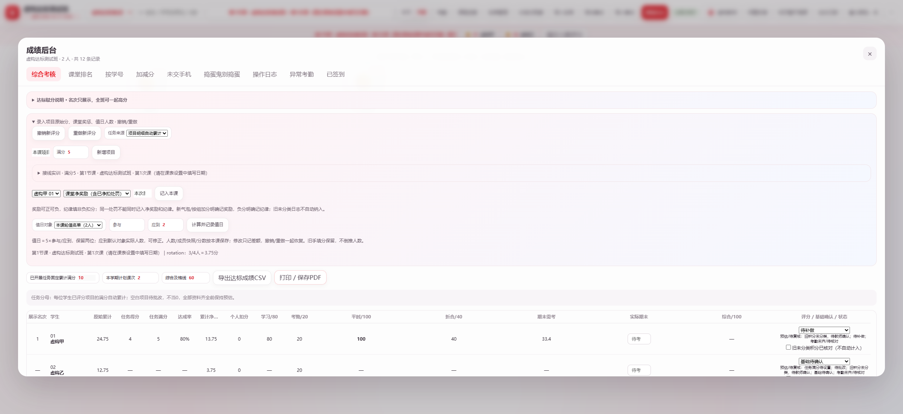

# 达标赋分：只录原始分，系统自动换算

在「成绩后台 → 综合考核」展开「录入项目原始分、课堂奖惩、值日人数」。网页、CSV与打印采用同一模型。

1. **项目**：填写项目名称，默认满分5，可调整。给学生填原始分，4/5自动表示80%。明确0填0，未批改留空；负分保留，换算比例最低0。有明细时自动汇总已评分项目及对应满分，未评分项目不当0且保持待批改。项目修改/补录后自动重算，不必手算比例。
2. **无项目明细**：可选「教师固定累计基准」，教师明确设置已开展任务满分及学生原始任务分，再选择已评分。默认待设置，不取班级最高值，不猜任务数量。与项目明细模式互斥，避免同一任务计两次。切换不删除历史原始积分。
3. **奖励/纪律**：原气泡加分、后台补录及「本组每人+1」今后明确记奖励，负分记纪律；综合考核也可按学生录入本次净奖励或纪律扣分。全部课次累计净奖励不再封顶5分。已在净奖励内扣除的处罚，不能再记纪律。任务日志不会再次算作奖励。
4. **旧记录**：原积分、日志delta不改写、不自动分类。原始累计完整展示，未分类标记待教师确认。教师可勾选「旧未分类积分已核对」，此操作只表示复核，不自动归类或补造任务证据。旧版独立确认的累计任务分/奖惩仍保留；新录入与旧确认数据不得重复登记同一事实。
5. **值日**：从顶部「值日人数评分」进入当前轮值名单，或分组页解锁后点击「本组值日人数评分」。应到默认该对象实际人数，可修正；填参与人数后自动计算 `5×参与÷应到`，保留两位。4/5＝4，3/4＝3.75，全员＝5。参与须为0至应到的整数，应到须为正整数。成员快照、人数和分数按课次对象保存，修改只记差额，旧手填分保持原样，不倒推人数。
6. **撤销/重做**：录入面板的按钮用于新评分/配置操作，恢复项目分、状态或人数，自动重算并生成反向日志保留原始事实；继续新录入会清空重做分支。关联项目/人数的日志必须从此入口修改，不能从通用日志入口单独清空造成错配。原气泡的最近加分撤销仍沿用原入口。
7. **基础与考勤**：教师核实基本学习/实训、补做和基本出勤后，选择基础「已满足」；否则待确认或待补做。显示60并不自动表示已达标。考勤沿用原计划课次、自定义原因和历史扣单位快照；有快照按当时记录，无快照沿用旧规则，不猜补。未登记只按正常预估，不伪造签到；考勤不重复扣原始积分。
8. **期末与导出**：实际期末0–100，空白待考，0有效。CSV、打印/保存PDF包含原始累计、项目实得/满分/达成率、累计净奖励、个人纪律扣分、学习80、考勤20、平时100、折合40、期末需考/实际/综合、基础及预估状态；值日人数与分数同步导出。

## 统一公式

综合比例＝clamp((已评项目实得＋全部累计净奖励−个人纪律扣分)÷对应项目满分，0，1)。

学习赋分＝40＋40×综合比例；平时＝学习＋考勤0–20；平时折合＝平时×40%；综合＝折合＋实际期末×60%。名次只展示，同伴进步不降低本人分数。40–80是换算范围，不限制一学期原始积分或项目数量。

正常考勤、无奖惩：任务100%/80%/60%对应100/92/84，明确0为60预估。项目80/100＋奖励10＝综合90%、学习76、平时96、折合38.4、及格60需期末36.0；奖励20＝平时100，继续奖励仍累计原始分，百分制不突破100。

期末需考＝max(0,(及格线−平时折合)÷0.6)，向上取0.1。超过100显示实际所需并提示无法达到，不截为100。

未设有效满分、未批改、基础未确认、旧来源未复核或考勤未登记齐时，显示「预估/待复核」；未设满分/完全未批改显示「—」，不除零、不假定达标。部分项目已评分可以预估，但仍显示待批改。

## 保存与历史

新增 `criterionAssessment.projects/students/duties` 和 `criterionHistory` 随原班级工作区、教师隔离、离线待同步箱、云端CAS保存D1。原始日志的新增来源为 `assessmentCategory: task/reward/discipline`，旧日志不回填。刷新、换班、云恢复后从原始字段重算。不同设备冲突时停止覆盖，保留本机待同步备份，核对后再恢复。

上一版「奖励最多影响5分」公式及旧名次赋分规则均已废止。
